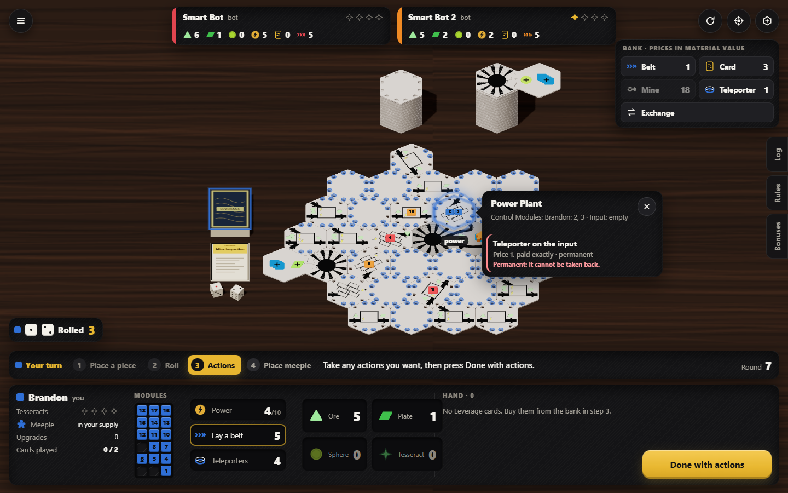
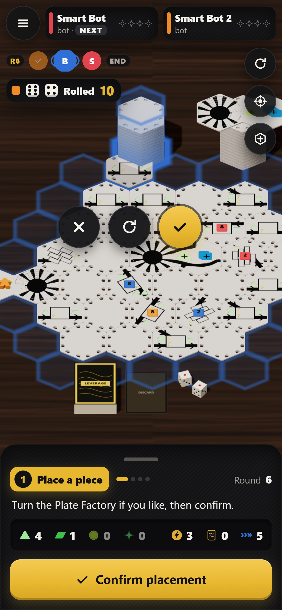
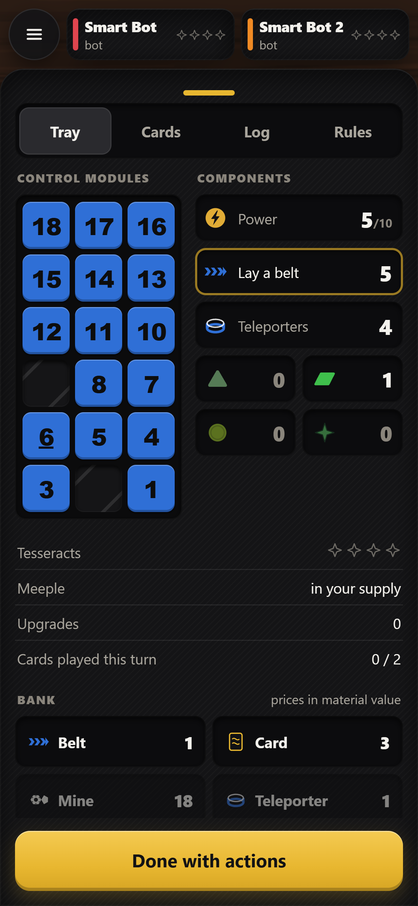
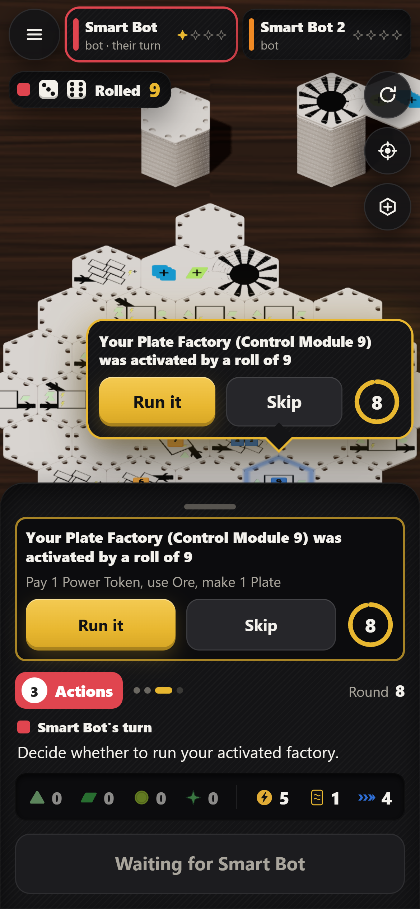
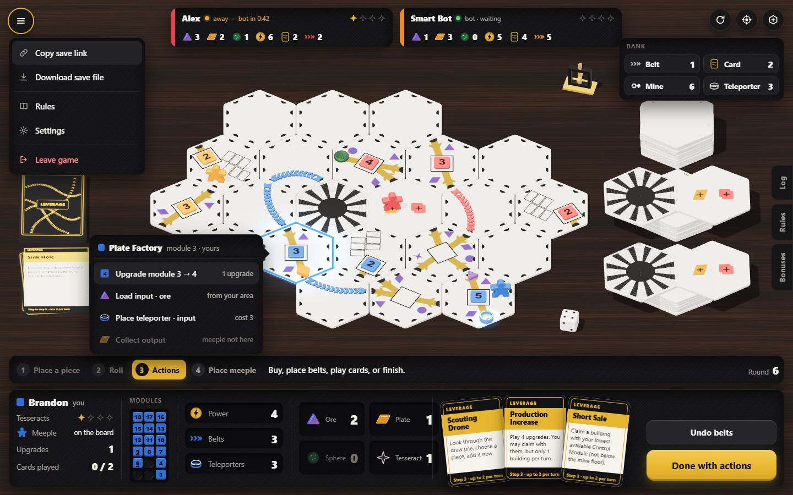
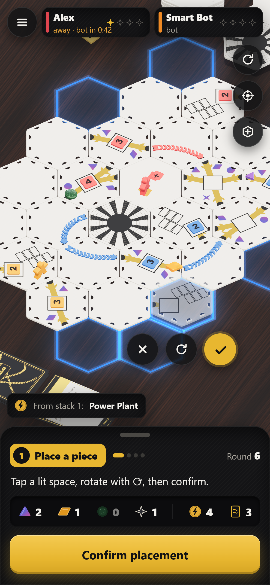
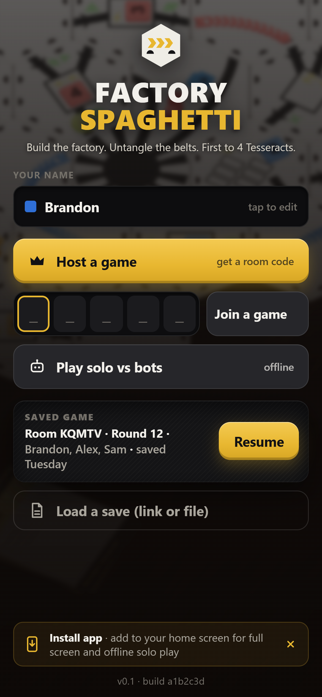
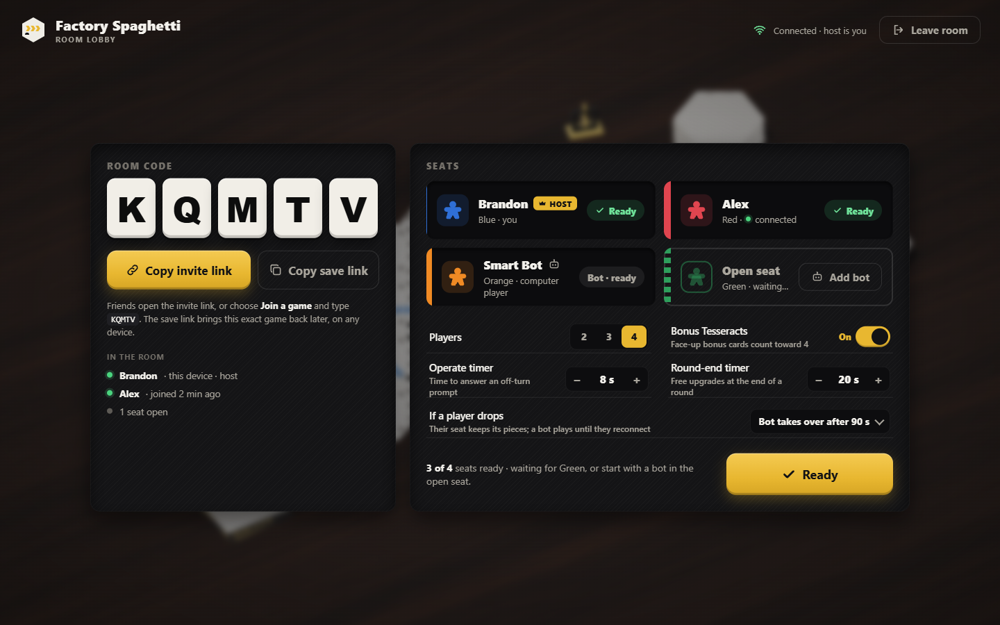

# Factory Spaghetti Online

An online, isometric 3D version of the board game **Factory Spaghetti** (2–4 players). The aim is a game that looks and plays like the physical, 3D-printed game: the same pieces on the table and the same steps in a turn, with only legal moves on offer.

**Play it now: https://bobbfwed.github.io/FactorySpaghetti/**

The version there to play is **0.1.0**, an early playtest build. The site is rebuilt from the `main` branch on every push, and the start menu shows the exact build (for example `Version 0.1.0+e285cf6`), so you can always tell which one you have.

**Status: playable, in development.** A full game can be played against bots or online with a room code on the 3D table, with animation and sound, saved as a link or a file, resumed on another device, and replayed move by move afterwards. It installs from the browser and plays solo offline. It has not yet been tested on real phones or between real networks: [docs/TESTING.md](docs/TESTING.md) is the checklist for that. The plan is in [docs/PLAN.md](docs/PLAN.md).

## The game today

The built game on a desktop, on your Actions step with a building's menu open:



On a phone: placing a piece with the legal spaces lit, and the bottom sheet pulled up to show the Control Module tray, components and the bank.

<p>



</p>

More screens of the built game are in [docs/screens](docs/screens); the converted piece models are shown in [docs/models/gallery.png](docs/models/gallery.png).

## What it does and what is planned

- **Play online with a room code.** One player hosts in their browser; the others join with a 5-letter code or an invite link. There is no game server: browsers connect to each other directly.
- **Save and resume anywhere.** A game can be saved as a link or a small file, sent to another device, and resumed on a later day.
- **A 3D table that matches the printed game.** Hex tiles with belt holes, black belt stubs, green material symbols and yellow power bolts, numbered Control Modules in a tray, chain-link belts, meeples and materials, modelled from the designer's own print files.
- **An interface that follows the rulebook.** The four steps of a turn are always on screen, the pieces you may touch light up, and each move is "pick up, see where it can go, put down, confirm".
- **Phone-friendly and installable** from the browser on Android.
- **Hosted on GitHub Pages**, updated on every push to `main`.

## Mock-ups

These were drawn before the game was built, as the target for its look. They are not screenshots of the game; those are above. The pages that produced them are in [docs/mockups](docs/mockups) (serve that folder with any static web server and open `index.html`).

**The table on a desktop**, on your Actions step, with a building's menu open and the game menu showing the save options.



**On a phone.** Left: placing a piece, with the legal spaces lit and confirm, rotate and cancel beside the preview. Middle: the bottom sheet pulled up to show your Control Module tray and hand. Right: the start menu.

<p>



</p>

**A roll activates your factory on someone else's turn**: operate or skip, with a countdown.


**The room lobby**: room code, invite link, save link, seats and settings.



**Every piece**, as it will appear on the table. Gold labels mark pieces that have no printed version yet.


## What exists today

| Part | State |
|---|---|
| Rules engine (`src/engine`) | Complete. One pure function, `applyAction`, enforces every rule. |
| Bots (`src/bots`) | A random bot and a one-move-lookahead "Smart Bot". |
| Simulator (`src/sim`) | Runs many bot games for balance statistics. |
| Sessions and saves (`src/session`) | The host's browser runs the engine and rolls seeded dice; clients send move requests. Bots, stand-in bots for players who are away, timers, host take-over, save links and save files. |
| Network (`src/net`, `src/online`) | Browser-to-browser connections through PeerJS with 5-letter room codes, automatic host hand-over under the same code, a same-browser transport for testing, and a network check page (`net-check.html`). |
| Menu, lobby, resume (`src/app`, `src/ui`) | Host, join, solo, invite link, seats, colours, settings; resume from this device, a save link or a save file. |
| Piece models (`tools`, `public/models`) | 18 pieces converted from the designer's print file with its colours. |
| 3D table (`src/table`) | Draws any game state with those models; pan, zoom, rotate, top-down. |
| Move logic (`src/play`) | Turns the engine's list of legal moves into what may be touched and what each touch does. |
| Game screen (`src/ui/game`) | The table with the interface over it, on desktop and phone, with a text view as a fallback. |
| 2D client and LAN server | The earlier prototype. Preserved on the [`vite-prototype`](../../tree/vite-prototype) branch, whose README has screenshots of every screen. |

| Animation and feel (`src/table`, `src/ui/game`) | Each move plays as a short transition; sound is made in code; speed, sound and vibration settings; "Bot speed" so bots do not outrun the picture. |
| Replays and reports (`src/session`, `src/ui/replayView.ts`) | Every device keeps the list of moves. "Save replay", a replay viewer on the 3D table, and "Report a rules problem", which writes one file and sends nothing anywhere. |
| Install and offline (`public/sw.js`, `src/app`) | "Install app" on the start menu; after one online visit a solo game works with no connection; the screen stays on during a game. |

Not done yet: testing on real phones and networks, a relay for networks where browsers cannot reach each other directly (two phones on the same wifi are the likely case), and choosing rule variants per game.

The prototype this builds on, mid-game:


## Documents

- [docs/PLAN.md](docs/PLAN.md) — architecture, look and feel, milestones, and the decisions still open.
- [RULES.md](RULES.md) — the rules as implemented.
- [RULES_CHANGES.md](RULES_CHANGES.md) — every confirmed rule change and the open rules questions.
- [CLAUDE.md](CLAUDE.md) — working notes for AI-assisted development.

## Running what exists

Requires Node 20 or newer.

```
npm install
npm test           # all tests (engine, bots, simulator, sessions, network, app, table, move logic)
npm run dev        # the game at http://localhost:5173 ("Play solo vs bots", or host a room)
npm run build      # static site into dist/ (what GitHub Pages serves)
npm run preview    # serve dist/ at http://localhost:4173 (service worker and install work here)
npm run typecheck
npm run lint
```

## Branches

- `main` — the online version. GitHub Pages serves the game from here at https://bobbfwed.github.io/FactorySpaghetti/.
- `online-dev` — where new work is done before it is merged into `main`.
- `vite-prototype` — the frozen 2D prototype with LAN play.

To try two players on one computer, open the game in two tabs with `?t=local` added to the address, host in one and join with the code in the other.
