# Factory Spaghetti — Vite / Canvas 2D playtest prototype

This branch (`vite-prototype`) holds the first digital version of the board game **Factory Spaghetti** (2–4 players): a rules-enforcing playtest tool with a flat 2D board, bots, a headless balance simulator, and LAN multiplayer.

It is kept as its own branch so this version can be picked up again later. New work on the online isometric version happens on `main`.

## What works

- **Complete rules engine.** Every move goes through one pure function, `applyAction(state, action)`. Illegal moves are rejected, and the interface only offers legal ones. Setup, piece placement, dice and production, belts, teleporters, claiming and upgrading with Control Modules, mines, all 13 leverage cards, bonus Tesseracts, and both ways the game ends are implemented.
- **Bots.** A random bot (used to crash-test the engine) and a "Smart Bot" that looks one move ahead.
- **Headless simulator** for running many bot games and collecting statistics.
- **Browser client.** Local hot-seat or play against bots, with a board you click and a side panel of actions.
- **LAN multiplayer.** A Node WebSocket host runs the engine; browsers on the same network join it.
- **Tests.** 264 tests in 20 files, all passing (`npm test`).

## Screenshots

Taken from this branch at 1440×900 unless noted.

### Start menu
Choose local or LAN play, 2–4 players, and a human or bot for each seat.

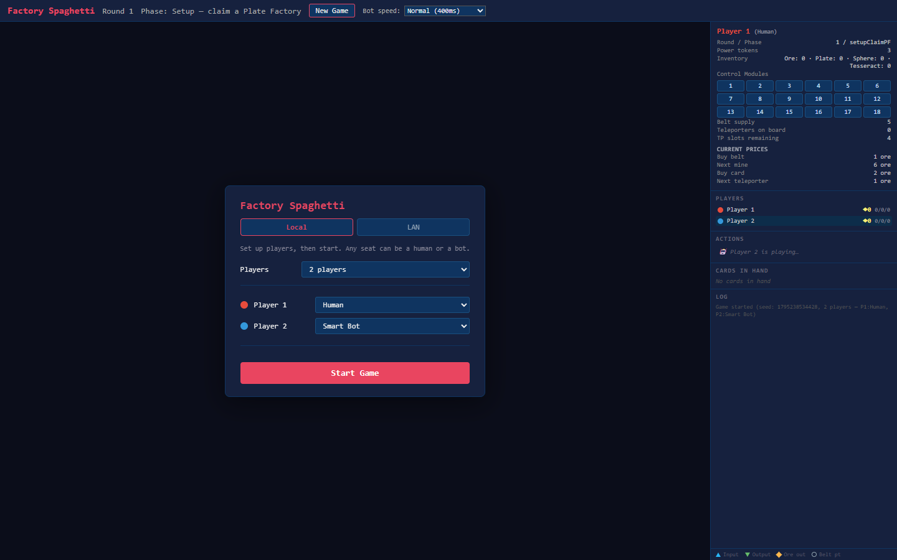

### Setup: claiming the first buildings
A 4-player game just after it starts. The highlighted Plate Factories are the ones the human player may claim.

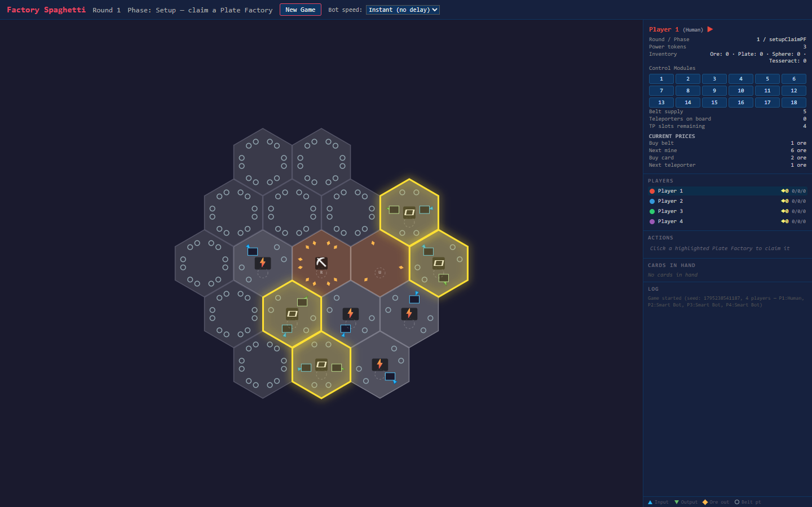

### Early game
Round 4, the human player's round-end turn. The side panel lists the free upgrades available and counts down to the automatic end of the turn.

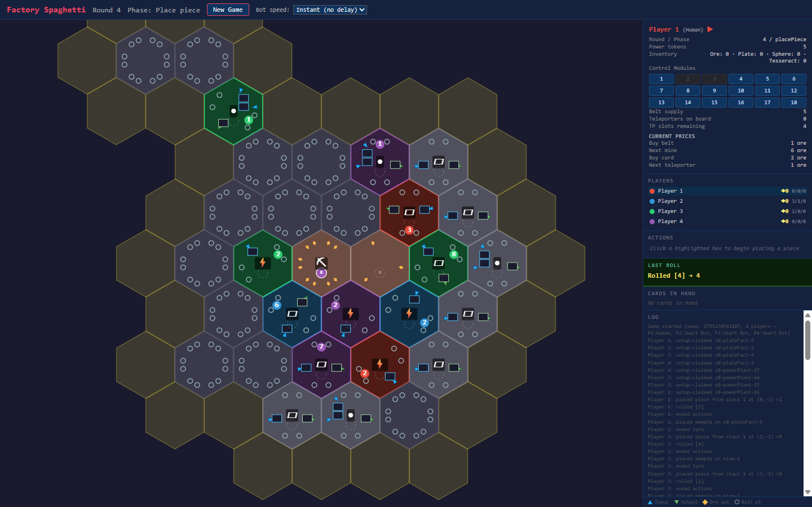

### Mid game
Round 12 of an all-bot 4-player game: two mines in play, claimed buildings carrying numbered Control Modules, and meeples on buildings.


### The action panel
The side panel during a human round-end turn: upgrade, load, operate, and Done.

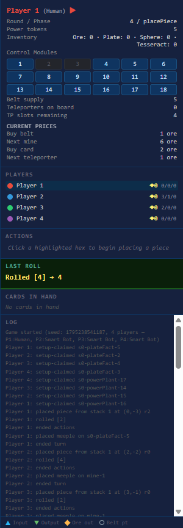

### Leverage cards
After buying a card, it appears in "Cards in Hand" with its text and a Play button.

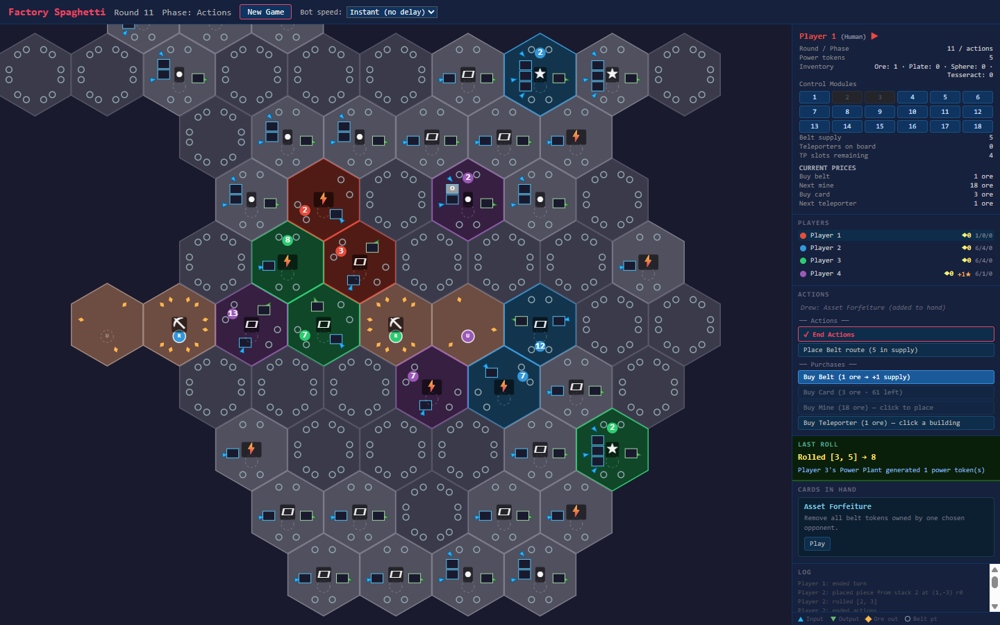

### The pieces
Plate factories, power plants, and a sphere factory, with Control Module badges and a meeple in the four player colours.

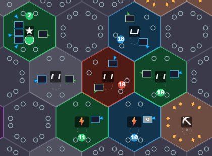

The double-hex mine, with its ore-output points.

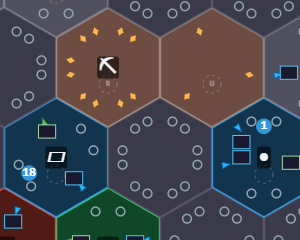

Factories and a blank piece, showing input points (blue), output points (green), and belt connection points.

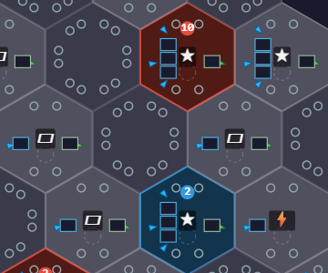

Belt placement mode: every point a belt may start from is highlighted.

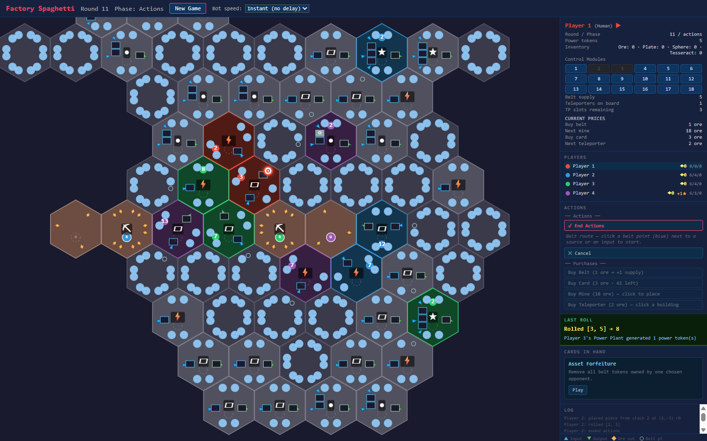

A placed belt, a teleporter, and a meeple.

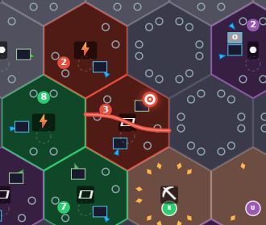

### Game over and statistics
The end-of-game overlay and the per-player statistics table.

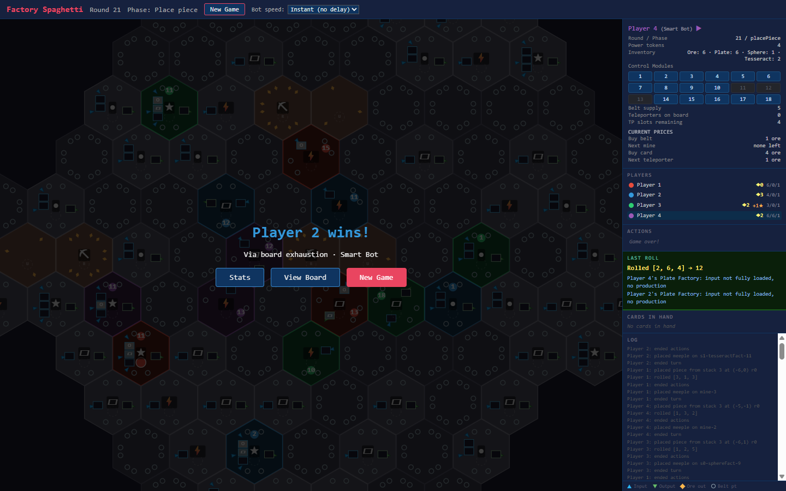

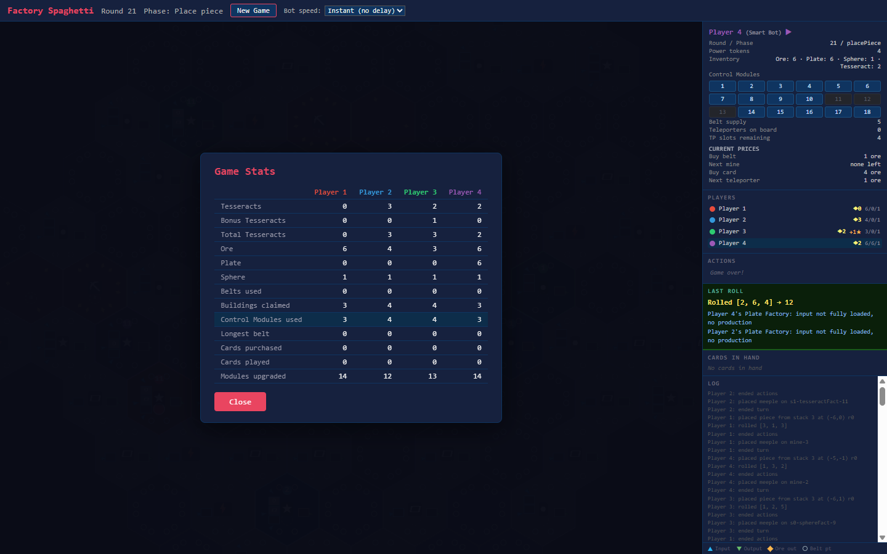

### On a phone (390×844)
The layout was built for desktop. On a phone the side panel takes most of the width and the board is too small to use.

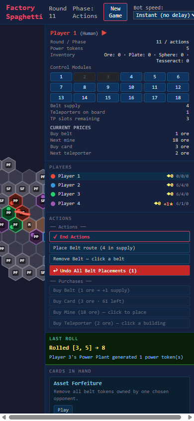

## Running it

Requires Node 20 or newer.

```
npm install
npm run dev        # browser client at http://localhost:5173
npm test           # 264 tests
npm run typecheck
npm run lint
npm run build      # production build into dist/client
npm run server     # LAN host (serves the built client and a WebSocket on port 8080)
```

## Layout

```
src/
  engine/   pure, deterministic rules: config, state, actions, reducer, rules/*, tests
  bots/     randomBot, greedyBot ("Smart Bot"), state evaluation
  sim/      headless multi-game runner
  server/   LAN WebSocket host, room and seat handling
  client/   Canvas 2D board, action panel, local and network sessions
RULES.md           the rules as implemented
RULES_CHANGES.md   every confirmed rule change and the open questions
CLAUDE.md          architecture notes and the original build order
```

## Known limits of this version

- Not usable on a phone (see the screenshot above).
- Large late-game boards can run off the edge of the screen.
- The side panel is dense and shows some internal names (for example `placePiece`).
- The Smart Bot never uses belts, cards, or teleporters.
- Dice are rolled by the browser that sends the move, which is fine for a trusted table but not for online play.
- LAN play needs someone to run the Node host; there is no internet play.
