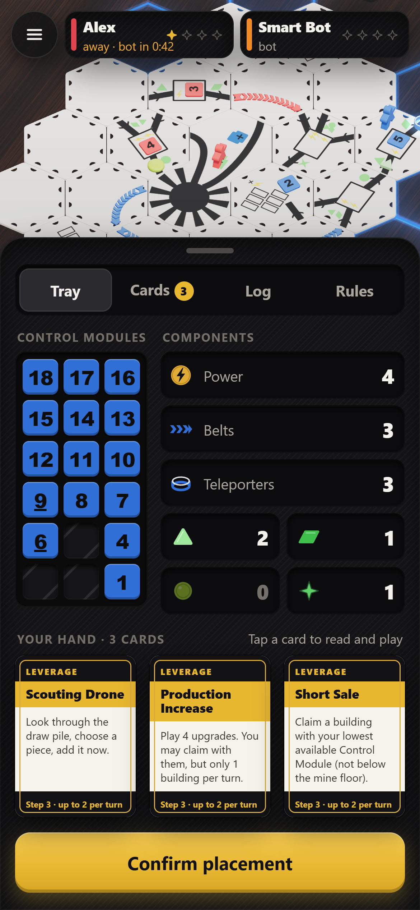
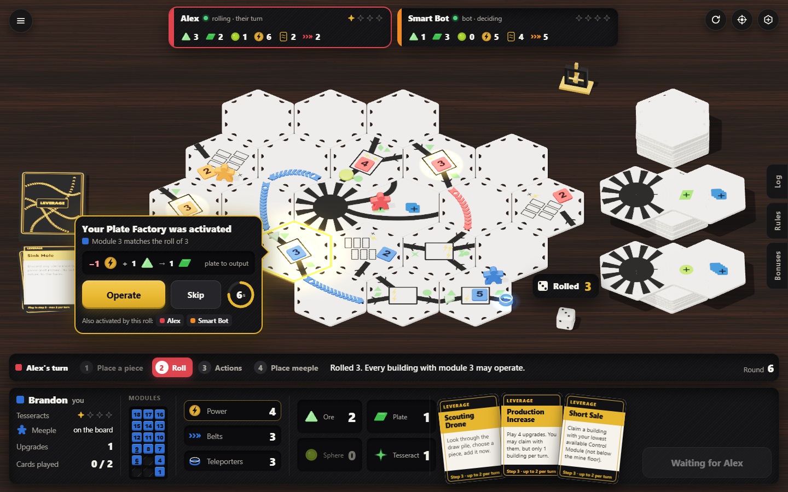
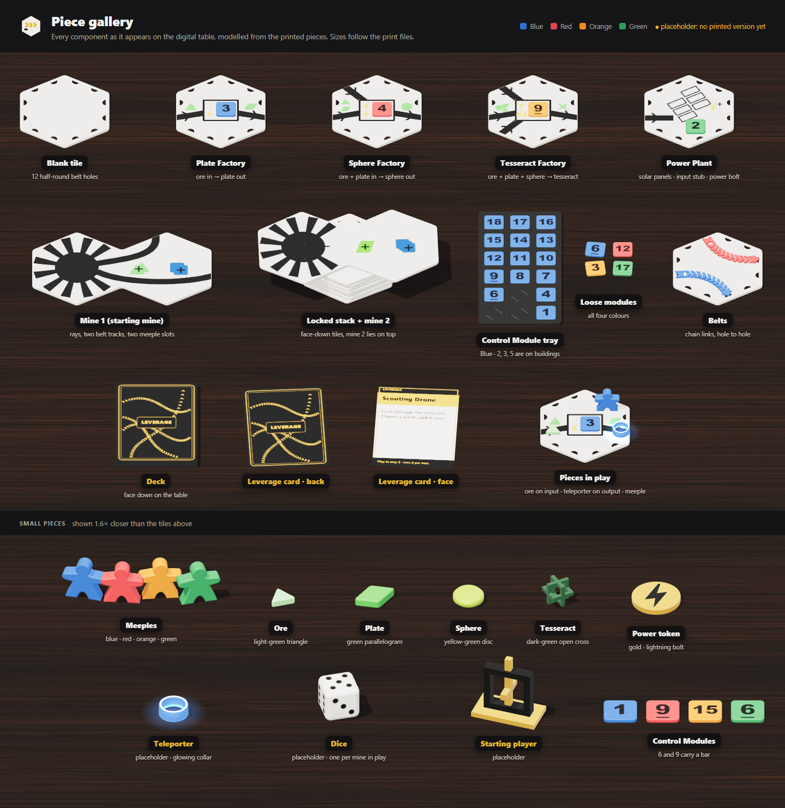
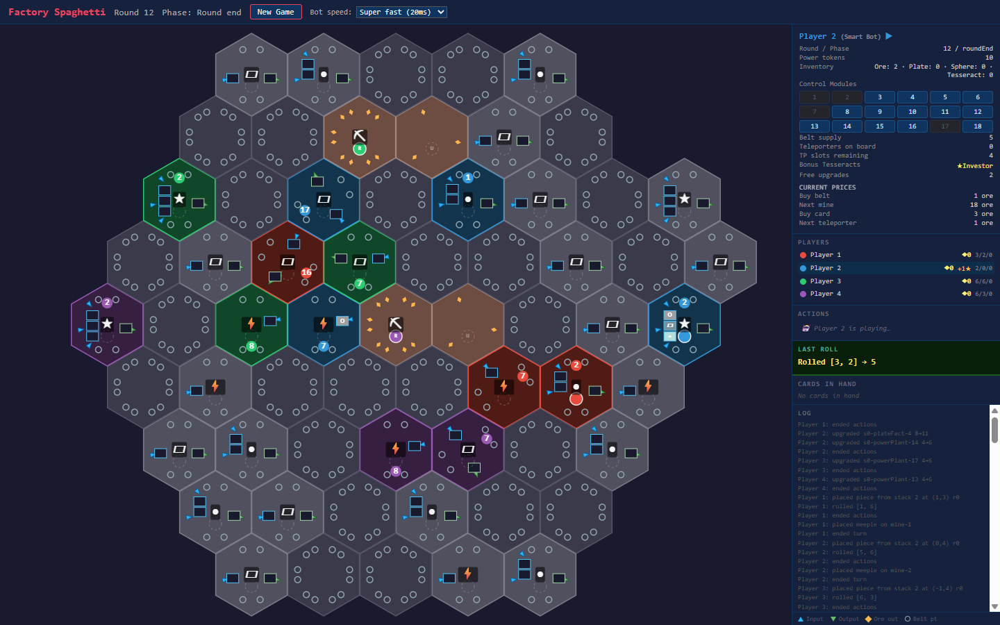

# Factory Spaghetti Online

An online, isometric 3D version of the board game **Factory Spaghetti** (2–4 players). The aim is a game that looks and plays like the physical, 3D-printed game: the same pieces on the table and the same steps in a turn, with only legal moves on offer.

**Status: planning.** The rules engine, bots and tests exist and pass. The online play, the 3D table and the new interface are planned but not built. The plan is in [docs/PLAN.md](docs/PLAN.md).

## What is planned

- **Play online with a room code.** One player hosts in their browser; the others join with a 5-letter code or an invite link. There is no game server: browsers connect to each other directly.
- **Save and resume anywhere.** A game can be saved as a link or a small file, sent to another device, and resumed on a later day.
- **A 3D table that matches the printed game.** Hex tiles with belt holes, black belt stubs, green material symbols and yellow power bolts, numbered Control Modules in a tray, chain-link belts, meeples and materials, modelled from the designer's own print files.
- **An interface that follows the rulebook.** The four steps of a turn are always on screen, the pieces you may touch light up, and each move is "pick up, see where it can go, put down, confirm".
- **Phone-friendly and installable** from the browser on Android.
- **Hosted on GitHub Pages**, updated on every push to `main`.

## Mock-ups

These are pictures of the intended look, not a working game. The pieces are modelled on photos of the printed set. The pages that produced them are in [docs/mockups](docs/mockups) (serve that folder with any static web server and open `index.html`).

**The table on a desktop**, on your Actions step, with a building's menu open and the game menu showing the save options.


**On a phone.** Left: placing a piece, with the legal spaces lit and confirm, rotate and cancel beside the preview. Middle: the bottom sheet pulled up to show your Control Module tray and hand. Right: the start menu.

<p>



</p>

**A roll activates your factory on someone else's turn**: operate or skip, with a countdown.



**The room lobby**: room code, invite link, save link, seats and settings.


**Every piece**, as it will appear on the table. Gold labels mark pieces that have no printed version yet.



## What exists today

| Part | State |
|---|---|
| Rules engine (`src/engine`) | Complete. One pure function, `applyAction`, enforces every rule. 264 tests pass. |
| Bots (`src/bots`) | A random bot and a one-move-lookahead "Smart Bot". |
| Simulator (`src/sim`) | Runs many bot games for balance statistics. |
| 2D client and LAN server (`src/client`, `src/server`) | The earlier prototype. Still in this branch until the first milestone replaces them; preserved on the [`vite-prototype`](../../tree/vite-prototype) branch, whose README has screenshots of every screen. |

The prototype this builds on, mid-game:



## Documents

- [docs/PLAN.md](docs/PLAN.md) — architecture, look and feel, milestones, and the decisions still open.
- [RULES.md](RULES.md) — the rules as implemented.
- [RULES_CHANGES.md](RULES_CHANGES.md) — every confirmed rule change and the open rules questions.
- [CLAUDE.md](CLAUDE.md) — working notes for AI-assisted development.

## Running what exists

Requires Node 20 or newer.

```
npm install
npm test           # 264 tests
npm run dev        # the 2D prototype client at http://localhost:5173
npm run typecheck
npm run lint
```

## Branches

- `main` — the online version (this branch). GitHub Pages will serve from here.
- `vite-prototype` — the frozen 2D prototype with LAN play.
