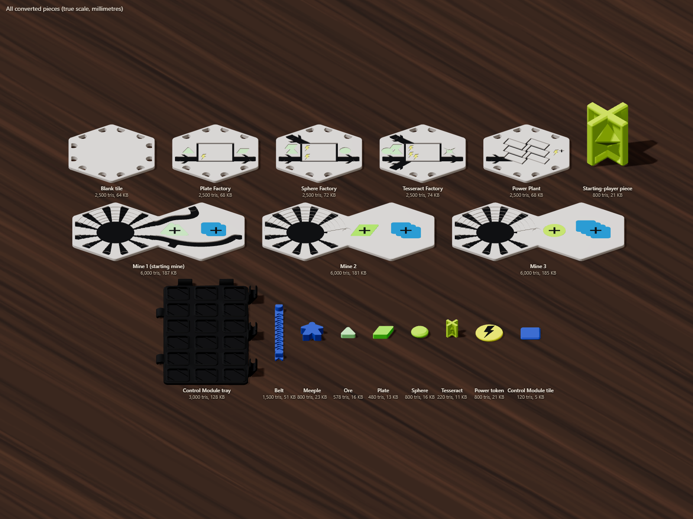
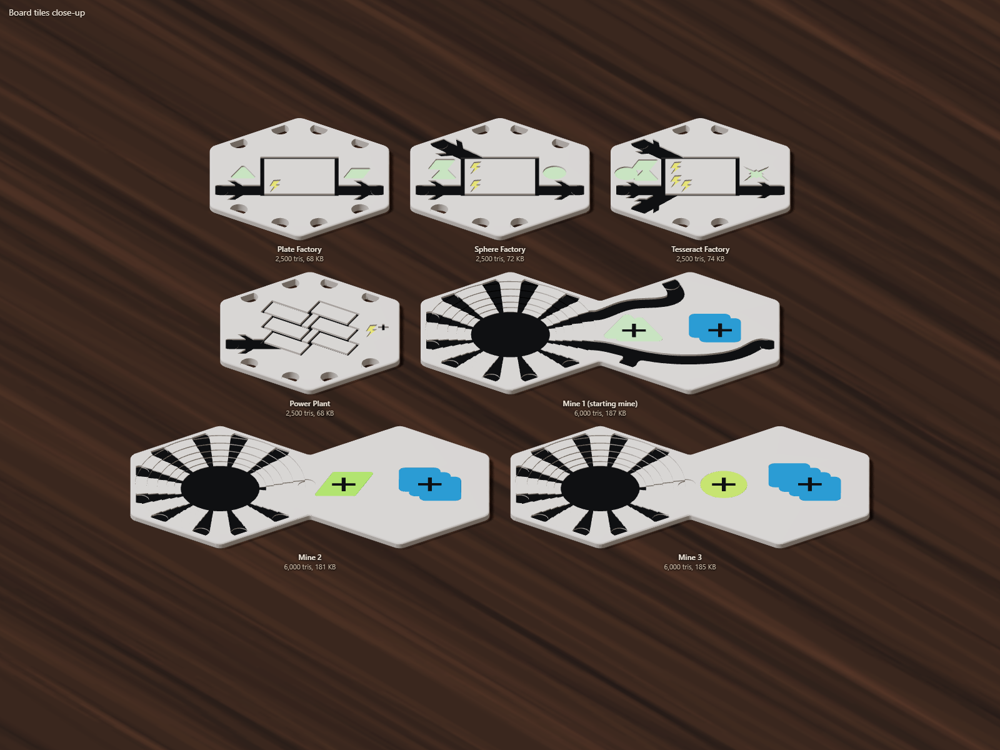
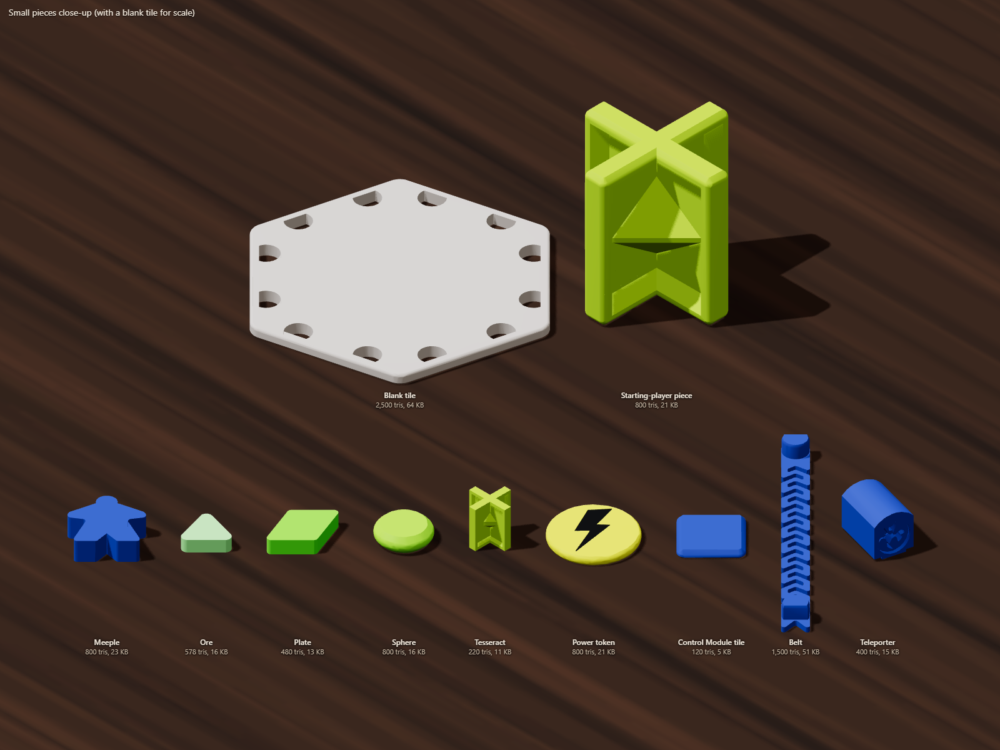

# Piece models (milestone N4)

The game's 3D pieces are made from the designer's own print file, so they have the same shapes and colours as the printed set. A script reads the print file (`.3mf`), simplifies each piece and writes small web models (`.glb`) to `public/models/`, plus `public/models/manifest.json` describing them.







## Re-running the conversion

```
npm run models                                  # reads G:\My Drive\Factory Speghetti
node tools/convert-3mf.mjs <folder>             # reads another folder holding the .3mf files
FS_MODELS_SRC=<folder> npm run models           # same, via environment variable
node tools/convert-3mf.mjs <folder> --only mine-1,belt   # just some pieces (manifest keeps the others)
```

The output is deterministic: running it twice gives byte-identical files. Reading straight from the Google Drive folder works but is slow; copying `Factory Speghetti AMS.3mf` to a local folder first is faster.

To see the result: `npx vite`, then open `/tools/gallery/index.html` (views: `?view=all`, `?view=tiles`, `?view=pieces`, `?view=modules`; add `&top=1` for a straight-down camera, handy for comparing with the designer's renders). To list what a print file contains: `node tools/inspect-3mf.mjs <file.3mf>`.

### Files

| File | What it is |
|---|---|
| `tools/convert-3mf.mjs` | The converter (Node, no browser). |
| `tools/pieces.config.json` | Which pieces to export: source file, which item on the print plate, triangle budget, special handling. |
| `tools/piece-theme.json` | Colour of every material name, taken from the print file's filament list. |
| `tools/lib/threemf.mjs` | Reads `.3mf` zips: model XML (including Bambu Studio's multi-file layout), transforms, part names and filament numbers from `Metadata/model_settings.config`, filament colours from `Metadata/project_settings.config`. |
| `tools/lib/paint.mjs` | Decodes Bambu Studio per-triangle colour painting (`paint_color`). |
| `tools/lib/mesh.mjs` | Welding, simplification (meshoptimizer), normals, winding check. |
| `tools/inspect-3mf.mjs` | Lists the items, parts, sizes and colours inside a `.3mf`. |
| `tools/gallery/` | The gallery page used for the screenshots above. |

## What the models look like to the game

- **Axes:** glTF convention, +Y up. The print's Z-up frame is *rotated* (not mirrored) onto it: print (x, y, z) becomes (x, z, −y). The converter refuses to write a model whose faces end up inside-out (it checks the signed volume).
- **Units:** 1 unit = 1 mm. **Origin:** centre of the footprint, bottom face at Y = 0.
- **Hex tiles** lie in the XZ plane, pointy-top: flat sides face ±X (68.8 mm across flats), corners at ±Z. **Mines** are two hexes side by side along X; the hex centres are at x = −34.4 (the rayed hex) and x = +34.4.
- **One mesh primitive per colour**, each with a named material. Normals are split at edges sharper than 35°, so flat faces and engraved edges stay crisp.
- **Belt:** the file has it as printed: a flat chain 1.5 mm thick along Z (arrowhead at −Z, notched tail at +Z), with a D-shaped peg 3.8 mm tall standing *up* from each end (peg centres at z ≈ −31.9 and +31.7). On the table the game turns it over (a rotation about its length, not a mirror), so the pegs point down into the D-shaped holes of the tile it lies on and the chain face is up. Each end (peg and tab) stays rigid with its peg centred on the hole; only the chain between the pegs bends along the curve. The tabs are drawn reaching 1.6 mm past the tile edge (the print reaches about 0.5 mm) so belts meeting at a shared edge overlap and read as one chain (`scene.ts` `bendBeltItems`, `layout.ts` `BELT_SPILL`).
- **`player` material:** belts, meeple, Control Module tile and teleporter. The game tints it with the owner's colour; the file holds a neutral grey placeholder.
- **Teleporter:** an arched block lying along X, with the round swirl-shaped portal recessed into its +X end and a 0.7 mm foot (11.7 × 6.4 mm) under the portal end, kept as printed. The recess is centred 5.084 mm up on the end face (x = 7.5), radius 4.384 mm (`layout.ts` `PORTAL`, checked against the geometry by `teleporter.test.ts`). The table draws the piece at 0.75 scale on its own stub, its nearest back corner 1.2 mm in from the tile edge, lying along the stub's printed black line (`layout.ts` `STUB_LINES`: the slanted stubs measured from the `inlay-black` part of the tile models) with the portal facing the building, and the stub's material beside it (`layout.ts` `teleporterPlacement`, `teleportedMaterialWorld`); when a Teleporter lands on a stub that holds material, the material slides aside (`transition.ts` `slide`). Over the recess the game draws a glowing, slowly swirling rainbow disc that the print does not have (`src/table/portal.ts`, the owner's decision of 2026-11-27); still pictures (the guide, the gallery) show one fixed frame of it, and the game menu's "Moving Teleporter portals" switch (`src/ui/portalPref.ts`) keeps it still on the table. The gallery's isometric views turn the piece 60° so the portal faces their camera.
- No compression extensions are used, so `GLTFLoader` loads the files with no extra decoders.

## Models

18 of the 19 models come from **`Factory Speghetti AMS.3mf`**, which the designer says is the current file. No piece fell back to an older single-piece file, so nothing is marked "possibly out of date". The teleporter comes from **`Teleporter.3mf`**, a separate file the designer provided for it (2026-11-27): one single-colour part with no filament data, so the whole piece is the `player` material.

| Model | Materials (one primitive each) | Triangles before → after | Budget | KB | Size X × Y × Z (mm) | Item in the AMS file |
|---|---|---|---|---|---|---|
| tile-blank | body | 4,676 → 2,500 | 2,500 | 64.0 | 68.8 × 3.0 × 78.3 | triangles 4676 |
| tile-plate-factory | body, inlay-black, icon-green-light, bolt-yellow | 2,764 → 2,500 | 2,500 | 67.8 | 68.8 × 3.0 × 78.3 | triangles 2764 |
| tile-sphere-factory | body, inlay-black, icon-green-light, bolt-yellow | 3,148 → 2,500 | 2,500 | 71.5 | 68.8 × 3.0 × 78.3 | triangles 3148 |
| tile-tesseract-factory | body, inlay-black, icon-green-light, bolt-yellow | 3,372 → 2,500 | 2,500 | 74.3 | 68.8 × 3.0 × 78.3 | triangles 3372 |
| tile-power-plant | body, inlay-black, bolt-yellow | 2,604 → 2,500 | 2,500 | 67.5 | 68.8 × 3.0 × 78.3 | triangles 2604 |
| mine-1 | body, inlay-black, icon-blue, icon-green-light | 7,816 → 6,000 | 6,000 | 187.3 | 137.7 × 3.0 × 78.3 | name "Mine 1 AMS v3" |
| mine-2 | body, inlay-black, icon-blue, icon-green | 14,140 → 6,000 | 6,000 | 180.7 | 137.7 × 3.0 × 78.3 | name "Mine 2 AMS v2" |
| mine-3 | body, inlay-black, icon-blue, lime-green | 15,004 → 6,000 | 6,000 | 185.0 | 137.7 × 3.0 × 78.3 | name "Mine 3 AMS v2" |
| belt | player | 5,516 → 1,500 | 1,500 | 51.0 | 6.6 × 5.3 × 74.1 | triangles 5516 |
| meeple | player | 1,996 → 800 | 800 | 22.9 | 18.0 × 5.9 × 18.0 | triangles 1996 |
| ore | icon-green-light | 578 → 578 | 800 | 15.8 | 11.7 × 3.5 × 10.5 | first copy in the ore assembly |
| plate | icon-green | 480 → 480 | 800 | 13.0 | 16.5 × 4.0 × 12.0 | first copy in the plate assembly |
| sphere | lime-green | 10,244 → 800 | 800 | 16.3 | 14.0 × 4.5 × 14.0 | first copy in the sphere assembly |
| tesseract | yellow-green | 220 → 220 | 800 | 10.5 | 9.5 × 11.5 × 9.5 | first copy in the tesseract assembly |
| power-token | inlay-black, bolt-yellow | 10,752 → 800 | 800 | 21.4 | 22.0 × 2.4 × 22.0 | name "Power Tile AMS" (bolt on both faces) |
| starting-player | yellow-green | 6,668 → 800 | 800 | 21.0 | 32.9 × 41.4 × 32.9 | triangles 6668 |
| control-module | player | 4,100 → 120 | 120 | 5.0 | 16.0 × 2.0 × 16.0 | "Number Tiles AMS", part Body12 |
| control-module-tray | black | 69,026 → 3,000 | 3,000 | 127.7 | 80.9 × 10.4 × 141.6 | tray assembly (triangles 83682), second part |
| teleporter | player | 5,150 → 400 | 400 | 15.1 | 15.0 × 11.9 × 10.4 | `Teleporter.3mf`, its only item |

Every model is within its budget (tiles ≤ 2,500, mines ≤ 6,000, small pieces ≤ 800, Control Module tile 120; the tray and belt had no budget in the brief and were set to 3,000 and 1,500). The teleporter is set to 400: up to 16 can be on the table, and at its drawn size (about 11 mm) 400 triangles look the same as 800. The `.glb` files total **1,247,184 bytes (1.19 MB)**; with the manifest the folder is about 1.27 MB, under the 1.5 MB limit.

"Item in the AMS file" says how the config finds the piece on the print plate: by the triangle count of the whole build item, by the object name Bambu Studio shows, or by taking one copy out of an assembly of copies (`partIndex`).

## Colours

All colours come from the AMS file itself (`Metadata/project_settings.config` → `filament_colour`). Each part's filament comes from `Metadata/model_settings.config`, and the tiles' and mines' coloured details come from Bambu Studio's per-triangle painting. The converter warns if the file's colours ever stop matching `piece-theme.json`.

| Filament | Colour | Material name | Used for |
|---|---|---|---|
| 1 | #000000 | `inlay-black`, `black` | outlines, belt stubs, mine rays, disc and tracks, "+" marks, bolt on the power token (`inlay-black`); the Control Module tray (`black`) |
| 2 | #D6D3D3 | `body` | tiles and all three mines |
| 3 | #0086D6 | `icon-blue` | the stacked-square "+" icons on the mines |
| 3 / 4 | #0086D6 / #71D0FF | `player` | meeple and Control Module tile (3), belt (4); tinted at runtime. The teleporter (its own file, no filament data) is all `player` too |
| 5 | #B7EC00 | `yellow-green` | tesseract, starting-player piece |
| 6 | #9DFB20 | `lime-green` | sphere, circle icon on mine 3 |
| 7 | #6BFA27 | `icon-green` | plate, parallelogram icon on mine 2 |
| 8 | #A4FFA6 | `icon-green-light` | ore, material icons on the factory tiles, double-triangle icon on mine 1 |
| 9 | #F9FF09 | `bolt-yellow` | lightning bolts on the factory and power-plant tiles, power token |
| 10 | #A0A0A0 | `body` (drawn #D6D3D3) | Mine 1 body: painted this grey in the file, drawn white like the other board pieces (see below) |

Nothing was guessed by eye. Some choices were made on top of the file's data:

- The blue "+" icons on the mines use filament 3. That is the same slot as the meeple and Control Modules, but a mine belongs to nobody, so the icons are a fixed `icon-blue` and are not tinted.
- The colours are Bambu Studio's filament-slot colours. They match the designer's current renders in `docs/reference/`. They are not the colours seen in the older photos (for example, the tesseracts there are black glitter).
- Mine 1's body is painted grey (filament 10, #A0A0A0) in the print file. The designer asked for the starting mine to be the same white as the other board pieces, so filament 10 maps to `body` (#D6D3D3). Its black tracks and coloured symbols are unchanged.
- Pure black (#000000) is used as given. In the gallery, black parts only show their shape through lighting.

## What was not converted, and why

- **Separate belt link and arrowhead models.** The belt chain is one closed mesh: the links are joined to each other, not separate pieces. So only the whole belt is exported. The converter can still export one link of a chain whose links are separate meshes (`"component": { "axis": "y", "pick": "middle" | "first" | "last" }` in the config) if a future belt file has them. Until then the game can bend the whole belt along a curve by deforming its vertices.
- **Control Module numerals.** The engraved numeral on the chosen tile is filled flat (`fillEngraving`), and the tile is turned face up, because it prints face down. Numerals are meant to be textures.
- **The other half of the tray assembly.** This is a flat panel with 18 square outlines, probably a lid. Also not converted: the blue "Number Tile Tray v4" box, the card holders, and the big "Holder". These are not game pieces on the table.
- **Cards, dice.** No print model exists for them. (Teleporters had none either until the designer provided `Teleporter.3mf`; until then the table drew a ring.)
- **The older files** (`Factory Speghetti AMS what I need.3mf`, `Board Piece Chit Tile Layout.3mf`, the single-piece files, `Mine 1/2/3 AMS v2.3mf`, `Starting PIece*.3mf`) are out of date, and nothing reads them now. In particular, their factory tiles have gold stubs and purple icons and their Mine 1 has no belt tracks. None of that matches the current design.

## How it was checked

- The tiles were rendered top-down and compared with `docs/reference/current-*.png`. The input stubs are on the left and the output on the right. Plate, Sphere and Tesseract Factories have 1, 2 and 3 inputs and 1, 2 and 3 bolts. The power plant has a bolt with "+". Mine 1 has the two curved tracks. Mines 2 and 3 have the parallelogram and circle icons, with three and four stacked squares. The layout matches the renders exactly, so nothing is mirrored.
- The tiles show their 12 half-round holes. Nothing is inside-out or lying on its side.
- Sizes are in proportion: the meeple is 18 mm against a 68.8 mm tile, about a quarter.
